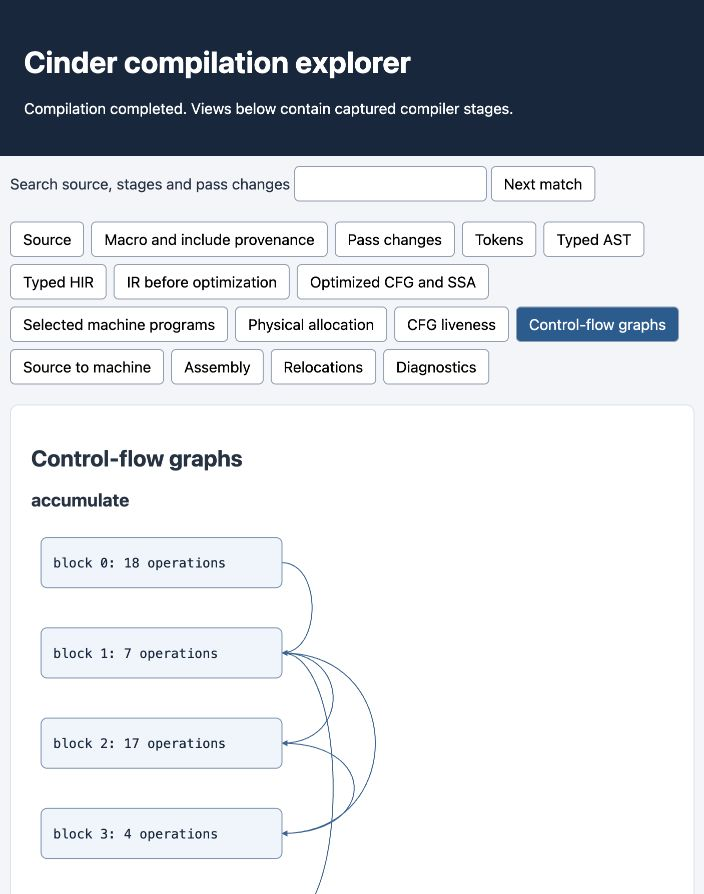
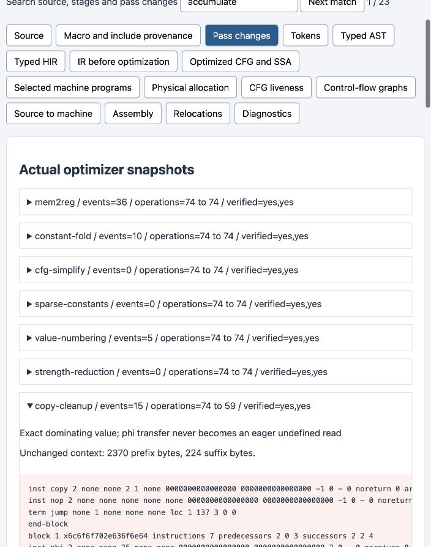

# Offline compilation explorer

`cindercc -O2 --explorer report -c example.c -o example.o` captures the real
compilation and publishes `report/index.html`. Open that file in a browser.
The single HTML file contains its styles, controls, diagrams and snapshots;
viewing it requires no server, network service or analytics. Without `-c`,
`-S` or `-o`, `--explorer` performs inspection without publishing native output.

The report includes original sources and include instances, macro expansion,
spelling and definition locations, preprocessed text, tokens, typed AST, owned
HIR, IR before optimization, optimized CFG/SSA, selected machine programs,
physical allocation, block liveness, actual CFG diagrams, assembly directives,
relocations and diagnostics. Unreached stages are labeled explicitly.

CFG nodes link to the corresponding IR block and its actual machine ranges.
Each row identifies its original source or macro origin and exact `.text`
bytes. Empty ranges represent operations that emit no bytes. These mappings
use encoder PCs even without `-g`; enabling the report does not add debug
sections or change ordinary object bytes. Function entry sequences are visible
in assembly and are not attributed to a source expression.

Pass records show actual transformation events and verified operation counts.
Expanded records show the changed region after removing common complete-line
prefixes and suffixes. Downloads retain the full canonical before/after CIR.
This is a contiguous changed-region comparison, not a minimal edit script.
Search includes source lines, stage dumps and pass changes; Next match opens
the relevant pane and collapsed ancestors. Arrow keys, Home and End navigate
the stage tabs. Source and SVG links also activate their destination pane.

The compiler captures stage streams during their normal lifetimes. It retains
its own temporary pass directory until publication, then removes only its
owned trace files. An explicit `--pass-trace DIR` remains available afterward.
Report publication is atomic and rejects input collisions. A failed source can
still publish a clearly failed diagnostic report while preserving previous
native output. A later report-publication error returns nonzero; separately
completed artifacts are not one transaction. Views are bounded to 64 MiB and
individual pass snapshots to 16 MiB.

`make test-explorer` independently compares stage text and complete pass
snapshots with standalone CLI artifacts. It checks every fragment link,
HTML escaping, exact object identity with/without reports, PC ranges against
an ELF reader and LLVM instruction boundaries, reference/IR executions,
failed-input preservation, collisions and owned temporary cleanup. Linux also
links and executes the original report-producing objects.

The following images were captured from the actual `tests/explorer/pipeline.c`
report, with the repository prefix mapped to `/project`:

